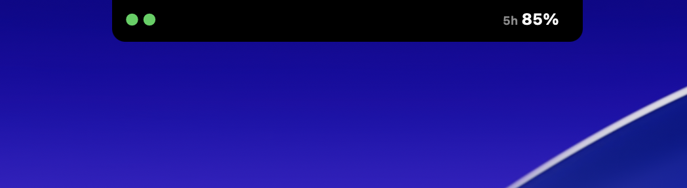
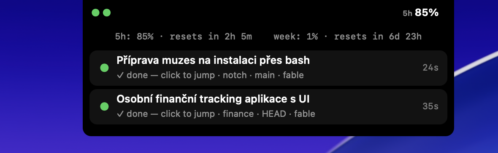

# NotchOverlay

**Dynamic Island pro Mac — sleduj svoje AI coding agenty přímo v notchi.**

NotchOverlay promění výřez v displeji MacBooku v živý přehled běžících
Claude Code sessions: barevné tečky říkají, kdo pracuje, kdo skončil a kdo
čeká na tebe, vedle toho tikají reálná procenta tvých rate limitů. Najetím
myší se island rozbalí do panelu s detaily každé session — odtud skočíš
rovnou do správného terminálu, nebo povolíš/zamítneš permission request
jedním klikem, bez přepínání oken. Nativní AppKit, žádné závislosti,
tokeny neopouští tvůj stroj.

[](https://buymeacoffee.com/matejkrcek)

*English version: [README.md](README.md)*

## Jak to vypadá

Kompaktní stav v notchi — tečky sessions vlevo, spotřeba limitů vpravo:



Hover → expandovaný panel se všemi sessions, kvótami a Allow/Deny tlačítky:



## Instalace

### Homebrew (doporučeno)

```sh
brew tap matejkrcek/notchoverlay
brew trust matejkrcek/notchoverlay   # novější Homebrew vyžaduje důvěru cizím tapům
brew install --cask notchoverlay
```

Quarantine flag se smaže automaticky (postflight), není potřeba nic povolovat.

### DMG

Stáhni `NotchOverlay.dmg` z [Releases](https://github.com/MatejKrcek/NotchOverlay/releases)
a přetáhni appku do Applications. Appka je ad-hoc podepsaná, takže ji
Gatekeeper po stažení zablokuje („nelze ověřit vývojáře"). Povolení:

- pravý klik na appku → **Open** → potvrdit **Open** (starší macOS:
  System Settings → Privacy & Security → **Open Anyway**), nebo
- v terminálu: `xattr -cr /Applications/NotchOverlay.app`

### Ze zdrojáků (stačí Xcode Command Line Tools)

```sh
curl -fsSL https://raw.githubusercontent.com/MatejKrcek/NotchOverlay/main/install.sh | bash
```

Nebo z naklonovaného repa:

```sh
./install.sh   # build → /Applications/NotchOverlay.app + LaunchAgent
               # (start po přihlášení, auto-restart po pádu)
```

> Rozdíl: instalace ze zdrojáků přidá i LaunchAgent (appka startuje po
> přihlášení a po pádu se restartuje). Homebrew/DMG appku jen nainstaluje —
> spouštíš ji sám z /Applications. V obou případech start po přihlášení
> zapneš nebo vypneš v Nastavení → General → **Open at login**. Update ze
> zdrojáků tvou volbu zachová.

## První spuštění

1. Otevři **NotchOverlay** z /Applications — ukáže se okno s nastavením
   a v notchi se objeví island. Okno kdykoli otevřeš znovu kliknutím na
   appku nebo **pravým klikem na island**.
2. **Sign in with Claude** (v okně) — kvóty se jinak čtou z credentials
   Claude Code, takže pokud používáš Claude Code, obvykle není potřeba.
3. Při prvním použití **Allow/Deny** tlačítek si macOS řekne o oprávnění
   **Automation** (System Events + tvůj terminál) — povol ho, jinak
   tlačítka nemají jak poslat odpověď do terminálu.
4. Volitelně: `hooks/install-hooks.sh` pro přesnější eventy (viz níže).

## Update

- Homebrew: `brew update && brew upgrade --cask notchoverlay`
- DMG: stáhnout nový z Releases a přepsat appku
- Ze zdrojáků: znovu spustit instalační one-liner

## Odinstalace

```sh
# Homebrew (rm smaže start po přihlášení, pokud byl Open at login zapnutý):
brew uninstall --cask notchoverlay
rm -f ~/Library/LaunchAgents/com.matejkrcek.notchoverlay.plist

# DMG / zdrojáky:
launchctl bootout gui/$UID/com.matejkrcek.notchoverlay 2>/dev/null
rm -rf /Applications/NotchOverlay.app ~/Library/LaunchAgents/com.matejkrcek.notchoverlay.plist
```

Ukončení bez odinstalace: okno appky → **Quit NotchOverlay** (zůstane
vypnutá do dalšího přihlášení, nebo do ručního spuštění, pokud je Open at
login vypnutý).

## Vývoj bez instalace

```sh
./build.sh          # kompilace (swiftc; SPM je na tomto stroji rozbité)
./bin/NotchOverlay  # spuštění na zkoušku
```

## Funkce

- **Kompaktní stav v notchi** — stavové tečky agentů vlevo, vpravo „5h X %"
  (reálná spotřeba 5h okna z API) nebo ⚠ N, když něco čeká na tebe.
  Na displeji bez notche plovoucí lišta.
- **Hover → expanze** — panel se rozbalí pod notch: hlavička s kvótami
  (5h okno + týdenní limit v %, časy resetů) a řádek na session
  (název z ai-title, stav, projekt, branch, model, čas od poslední aktivity).
- **Reálné kvóty** — OAuth token z Keychain (vlastní login, jinak „Claude
  Code-credentials") → `api.anthropic.com/api/oauth/usage`, refresh à 5 min.
  Token neopouští stroj jinam než na API Anthropicu. Debug: `~/.claude/vibe-quota-debug.txt`.
- **Barvy**: modrá = pracuje · zelená = hotovo · oranžová = potřebuje tvou
  akci (permission/otázka/zaseknuto) · červená = fail (API error).
- **Klik na řádek → jump do terminálu** (TERM_PROGRAM z hooků, jinak první
  běžící známý terminál: iTerm2, Ghostty, Warp, WezTerm, kitty, Alacritty,
  Terminal, VS Code/Cursor).
- **Allow/Deny tlačítka** u permission requestů — aktivují terminál a pošlou
  klávesu do dialogu (1 = povolit, Esc = zamítnout; vyžaduje oprávnění
  Automation pro System Events).
- **8-bit zvuky** — syntetizovaná čtvercová vlna (start, permission, otázka,
  hotovo, deny). Defaultně vypnuté; zapnutí v nastavení.
- **Non-activating overlay** — panel nikdy nesebere focus a nekrade aktivaci.
- **Nastavení** (klik na appku nebo pravý klik na island; vlevo sekce - General,
  Island, Accounts, Usage, Weather - a pod každou volbou krátké vysvětlení;
  resizovatelné, pamatuje si velikost i sekci) — island on/off,
  velikost islandu (0.7–1.5×), velikost panelu (0.8–1.6×, rozbalený seznam),
  zvuky, tokeny a/nebo odhad spendu per session, kvóta v liště, druhá řádka
  hlavičky (Codex limit z lokálních session dat / Fable 5 limit / rotace účtů),
  Claude účty s využitím 5h, týdenního a Fable limitu, Codex/Gemini se
  sign in/out, Open at login a Quit.
- **Indikace neaktuální kvóty** — appka čte OAuth token Claude Code a sama ho
  nikdy neobnovuje (refresh tokeny rotují). Když token prošel, hodnoty se
  ukazují jako `~12%` s poznámkou „stale" a Keychain se čte každých 30 s,
  dokud si ho Claude Code neobnoví.
- **Codex** — limit okna hlásí jen při přihlášení ChatGPT plánem; u API klíče
  to hlavička řekne místo „no data".
- **Počasí na ploše** (Nastavení → Weather, defaultně vypnuté) — sníh,
  podzimní listí, déšť nebo třešňový květ přes celou obrazovku, kreslené přes
  Metal v průhledném overlayi, který propouští kliky:
  - sníh se usazuje do závějí u spodního okraje obrazovky, na Docku a na
    horních hranách oken, nad kterými je místo (i po zaoblených rozích),
    a sesouvá se do přirozeného svahu; z listí a lístků jsou hromádky, na
    kterých je poznat, z čeho jsou,
  - kurzor závějí prorazí a rozpráší ji; tažené nebo zatřesené okno sníh
    shodí, zavřené či minimalizované ho shodí najednou v hroudách, které se
    při dopadu rozprsknou; při přepnutí Space zůstane sníh na okně,
  - déšť šplíchá, prská na sklo pod hranami oken a stéká po něm v kapkách,
    které se zastaví, posbírají kapičky a nechají mokrou stopu, visí pod
    spodními hranami, než ukápnou, kurzor je rozmaže a zatřesené okno je
    odhodí,
  - Halloween (30. 10. – svítání 1. 11., jinak přepínačem): v závěji svítí
    dýně a vylézají z ní duchové s cedulkami,
  - volby: intenzita (Light / Steady / Heavy / Variable), průhlednost, kam
    se usazuje (zem, Dock, okna, widgety na ploše), tání / usychání / vadnutí,
    smazání, deep interaction (sníh na výběru taženém po ploše), za okny,
    přes celoobrazovkové appky, viditelné na screenshotech (jinak je
    screenshoty a sdílení obrazovky nevidí), max výkon,
  - šetrné: když sněží, zhruba 2–3 % jednoho jádra CPU a ~60 MB (většina
    paměti je celoobrazovková GPU plocha, kterou macOS potřebuje), vypnuté
    nestojí nic. Při klidném sněžení kreslí 20 fps, když se něco hýbe rychle
    (kurzor v závěji, tažené okno, déšť) 30 fps, v polovičním rozlišení —
    Max performance zapne plnou frekvenci i rozlišení displeje. Pauza při
    spánku displeje, zamčení, zakrytí a spořiči. Obrys Docku se čte přes
    Accessibility (oprávnění už má kvůli Allow/Deny); bez něj se odhadne.

## Rotace účtů

Máš víc Claude účtů a k tomu Codex? Když jeden narazí na limit, pracuješ dál.

- **Přidání účtů** - v Claude Code se přihlas `/login` k účtu, pak
  Nastavení → Accounts → Rotation → **Add current Claude Code login**.
  Opakuj pro každý účet. Codex se přidá sám, jakmile jsi přihlášený přes
  `codex login`.
- **Přepínej přes `/login`, nikdy `/logout`** - `/logout` zneplatní login i na
  straně Anthropicu, takže přestane fungovat i kopie, kterou si NotchOverlay pro
  účet uložil. `/login` k jinému účtu předchozí login nechá platný.
- **Pořadí** - šipkami ↑/↓ nastavíš prioritu. Výchozí stav - nejdřív všechny
  Claude účty, Codex nakonec.
- **Zapnutá rotace** - když aktivní účet dosáhne prahu (výchozí 95 % 5h nebo
  týdenního okna), NotchOverlay přepne Claude Code na další účet, který má
  ještě rezervu. Když dojdou všechny Claude účty, přijde notifikace, nebo se
  podle nastavení otevře Codex v Terminálu v posledním projektu. Po resetu
  limitu se Claude Code vrátí na účet s vyšší prioritou.
- Nový účet používají nové Claude Code sessions. Běžící sessions restartuj.
- Second line → **Account rotation** ukáže v islandu všechny účty najednou.
- Nastavení → Accounts ukáže každý účet s využitím 5h, týdenního a Fable limitu.
  Účet, ze kterého Claude Code právě čerpá, má štítek **IN USE** - jeho využití
  vidíš v menu baru a vedle notche. Island ukáže účty pod agenty. Vypnuté
  **Show all accounts** = jen účet, který se právě používá.

## Zdroje dat

1. **Pasivně**: tail transkriptů `~/.claude/projects/**/*.jsonl` každých 1,5 s
   (stav ze závěru transkriptu + mtime). Funguje bez jakékoli konfigurace.
2. **Hooky** (přesnější eventy): `hooks/install-hooks.sh` zaregistruje
   `hooks/vibe-event.sh` do `~/.claude/settings.json` pro SessionStart,
   Notification, Stop a SessionEnd. Eventy tečou přes frontu souborů
   `~/.claude/vibe-events/`. **Odinstalace**: vrátit
   `~/.claude/settings.json.vibe-backup` nebo smazat záznamy s `vibe-event.sh`.

Debug: aktuální stav sessions app průběžně zapisuje do `~/.claude/vibe-state.json`.

## Kontribuce

Příspěvky vítány! Repo je veřejné, ale pushovat může jen maintainer —
platí standardní GitHub flow:

1. Forkni repo a vytvoř branch.
2. Udělej změnu (`./build.sh` musí projít).
3. Otevři pull request — projdu a mergnu.

## Podpora

Appka je zdarma a open source. Jestli ti šetří čas, můžeš mi koupit kafe:
**[buymeacoffee.com/matejkrcek](https://buymeacoffee.com/matejkrcek)** ☕

---

Developed by **[Matej Krcek](https://www.linkedin.com/in/matejkrcek)** from
**[Kreedl](https://kreedl.com)**.
